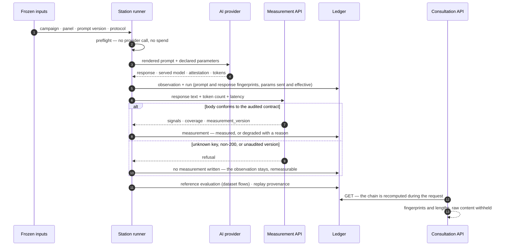
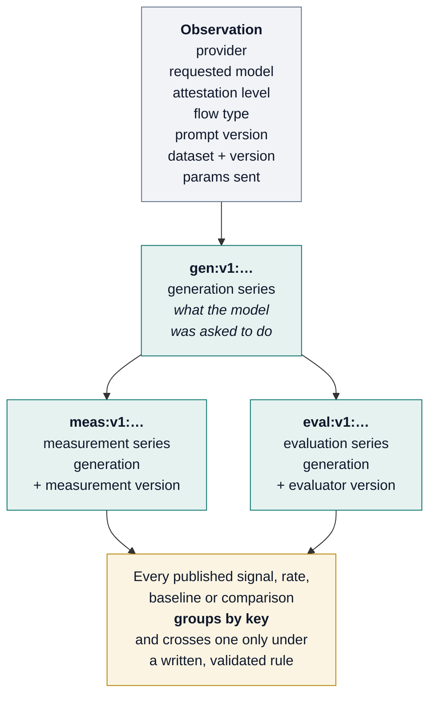

<b>English</b> · <a href="README.fr.md">Français — README</a>

# NeoMundi Station — architecture

### Our product promise is grounded in its architecture.

**We expose the architecture so you can understand, inspect and challenge what the product
actually does.**

[Station](README.md) · [Record schemas](schemas/) · [Start here](START_HERE.md) ·
[Evidence](EVIDENCE.md) · [Glossary](GLOSSARY.md) · [Roadmap](ROADMAP.md)

---

**Reference document. 2026-11-17.** Every capability below carries its state and its limit.
Where this document and the implementation disagree, **the implementation wins** — this
document is then wrong and must be corrected.

> **Rule for anyone writing a README, a web page or a deck from this document:** a capability
> may be described as available only where this document marks it 🟢. Nothing marked 🟡 or 🔴
> may appear in a present-tense sentence. See [§8](#8--messaging-and-documentation-rules).

**How to verify what you read here.** Claims in this document fall into three tiers, and the
tier is always named:

| Tier | What it means | Who can check it |
|---|---|---|
| **Public** | a file in this repository, or a route on the hosted instance | anyone, right now, with no account |
| **Hosted** | an observed state of the single running instance, dated | anyone with consultation access |
| **Private** | a module, test or decision record in the implementation repository | pilot teams and reviewers under agreement |

The implementation repository (`neomundi-station`) is **private**. Private sources are named
by path so a reviewer can ask for exactly that file; they are never quoted here.

---

## 1 · Product promise

### Can you reproduce how your AI behaved under controlled test conditions?

An AI answers once, in a window, and the answer is gone. The question that produced it gets
reworded. The model behind the endpoint changes without telling you. The parameters you
*thought* you sent are not the parameters that took effect. Six weeks later someone asks what
your system actually said, and under what conditions — and the honest answer is that nobody
can reconstruct it.

Station exists for that gap. It puts a **frozen, versioned question** to a real model under
**conditions written down in advance**, records the answer exactly as it came, asks the
NeoMundi measurement API what that answer is worth, and writes all three into an
**append-only ledger chained by hash**. Nothing is edited afterwards: a correction is a new
record that points at the old one.

**Station never decides.** It does not approve, block, filter, rank or score. It establishes
what happened and what it was worth, and hands that to the people whose job it is to decide.

What the promise is allowed to mean today, and nothing more:

| Promise fragment | What backs it | What it does not mean |
|---|---|---|
| *Reproducible conditions* | immutable inputs: a dataset imported, a panel drawn, a campaign launched never change again; `campaign_sha256` is recorded at launch and a later edit **blocks** execution | 🔴 it does not make a *model* reproducible — a provider can change what it serves between two slots, and Station's job is to record that, not to prevent it |
| *The question is the same question* | prompts are rendered deterministically: a sentinel is replayed byte-for-byte, a dataset prompt is a pack template plus the item; reference answers are read **after** generation and never enter the prompt | 🔴 for the open format (`ouvert/1`), the supporting case file legitimately contains what is needed to answer — that is the point of a grounding measurement |
| *The answer is preserved* | the response, its SHA-256, its length, the latency, the tokens, the finish reason, the parameters **sent** and the parameters **effective**, and the model *actually served* with its attestation level | 🔴 copying the requested model into the served model is forbidden: an evidence field whose value is known in advance is worse than an absence |
| *Measured, or honestly not measured* | the measurement API is called post-hoc; a signal that was not measured stays `null` and the record carries a status and a reason | 🔴 Station computes **no** signal, and never smooths, approximates or corrects one |
| *Auditable record* | append-only ledger, canonical JSON (RFC 8785), each record carrying the fingerprint of the previous one; chain verification recomputes every link | 🔴 a hash chain is **not a signature**. It makes alteration inside the file detectable; it does not prove authorship, absolute time, or that the file was not rewritten whole |
| *Comparable series* | three nested comparability keys — generation, measurement, evaluation — reconstructible from the recorded evidence alone | 🔴 no shipped rule lets a scientific quantity cross a comparability key. Crossing one requires a written, validated rule, and none is delivered |

**What Station is not**, stated here once so it is not restated as a caveat later: not a
compliance engine, not a decision authority, not a certification system, not a benchmark, not
a leaderboard, not a drift detector. The last three are refused **by rule**, enforced by
tests, not by editorial caution.

### Where Station sits in the chain

**INSTALL → TRACE → MEASURE → VERIFY → ACT** is the user journey. Three products serve it, and
their functions do not overlap:

| | Function | Boundary |
|---|---|---|
| **[Measurement](https://github.com/neomundi-io/neomundi-runtime-measurement)** | produces the measurements | it qualifies a text; it knows nothing of campaigns or protocols |
| **Station** | organises observations, campaigns and their provenance | it never produces a signal, and never interprets one |
| **[Evidence](https://github.com/neomundi-io/neomundi-evidence-gateway)** | verifies technical evidence against applicable checks | it checks integrity and attestation; it does not decide conformity |

Decisions stay with their respective authorities. None of the three products takes one.

---

## 2 · Functional architecture

```mermaid
flowchart LR
  subgraph IN["Frozen inputs — immutable once launched"]
    direction TB
    I1["Pack<br/>sentinels · templates"]
    I2["Dataset + manifest<br/>versioned · licensed"]
    I3["Panel<br/>drawn · hash-frozen"]
    I4["Campaign + protocol<br/>campaign_sha256"]
  end

  subgraph RUN["Station runner — the only writer"]
    direction TB
    R1["Plan<br/>deterministic units"]
    R2["Preflight<br/>no provider call"]
    R3["Execute<br/>provider adapter"]
    R4["Measure<br/>+ reference evaluation"]
  end

  subgraph EXT["External systems"]
    direction TB
    X1["AI provider<br/>12 adapters"]
    X2["Measurement API<br/>POST /v1/govern"]
  end

  LED["Ledger<br/>append-only · hash-chained<br/>RFC 8785 canonical JSON"]

  subgraph READ["Read-only surfaces"]
    direction TB
    S1["Consultation API<br/>6 GET routes + 1 event stream"]
    S2["Four screens<br/>campaigns · observations<br/>measurements · evidence"]
    S3["Campaign archive<br/>ZIP, schema /2"]
  end

  IN --> R1
  R1 --> R2 --> R3 --> R4
  R4 --> LED
  LED --> READ
  R3 -.->|"generation"| X1
  R4 -.->|"qualification"| X2

  classDef internal fill:#e6f2f0,stroke:#0f766e,stroke-width:1px,color:#0f172a
  classDef external fill:#eef3fb,stroke:#2563eb,stroke-width:1px,color:#0f172a
  classDef evidence fill:#fbf4e3,stroke:#b8860b,stroke-width:1px,color:#0f172a
  classDef frozen fill:#f1f3f6,stroke:#64748b,stroke-width:1px,color:#0f172a

  class I1,I2,I3,I4 frozen
  class R1,R2,R3,R4 internal
  class X1,X2 external
  class LED evidence
  class S1,S2,S3 internal
```

Dotted arrows are **outbound calls to systems NeoMundi does not run**. Everything else is
internal. The ledger is the single point every write passes through, and the single point every
read comes from.

### The six functional components

**Model execution** 🟡 — the Measurement API's declared multi-provider scope is **18 providers**.
Station's product horizon is to consume supported provider/model configurations across that API
surface, while retaining the actual served-model attestation and provenance. This is an
**integration target, not a claim that all 18 providers are connected, exercised or qualified
in Station today**. The inspected Station implementation contains twelve provider adapters:
`anthropic`, `aws_bedrock`, `cohere`, `deepseek`, `google`, `infomaniak`, `mistral`,
`moonshot`, `openai`, `perplexity`, `qwen`, `xai`. Adapter presence is distinct from a
successful provider execution and from audited end-to-end compatibility. Individual connections
may remain unfinished; extending coverage is an integration task, not a prerequisite for
Station's existing observation and campaign functions. The exact 18-provider API inventory
must be confirmed against the current API contract before presenting a provider-by-provider
availability matrix.

**Observation capture** 🟢 post-hoc, 🟡 runtime. Two modes, and they never blur. `post_hoc` — the
default — receives a complete response and then measures it. `runtime` receives timestamped
fragments, reconstructs the response, and *then* measures it. **Neither mode measures during
generation**, and that is a property of the measurement contract rather than a design choice: a
measurement request requires a token count and a latency, and both exist only once generation has
ended. A signal displayed mid-stream would be the signal of a different text. The runtime path
marks its `provider` with a `:runtime` suffix, so its series is mechanically distinct.

**Measurement API integration** 🟢 as a connector, 🟡 end-to-end on the hosted instance. The
connector is the audited result of five contract audits and distinguishes five outcomes of a
call: conforming body, non-conforming body, non-`200` status, replayable transport failure, and
**non-replayable uncertain outcome** — including `504`, because the server may have measured and
we cannot deny it. Station computes nothing: a structural test asserts that no numeric
computation exists anywhere under the connector package.

**Protocol and campaign** 🟢 — slots, repetitions, provider/model pairs and generation parameters
all come from the campaign file; no business value is hard-coded. A campaign is frozen to
canonical JSON before it runs, and changing it means **closing it and opening a new one**, with
`supersedes` carried by the contract rather than by a comment.

**Ledger** 🟢 — append-only, hash-chained, canonical. See [§4](#4--data-and-evidence-flow).

**Export and consultation** 🟢 — six `GET` routes over the ledger, one event-stream route for a
generation timeline, four static screens, and a per-campaign ZIP archive. Nothing in this layer
can write to the ledger or call a provider: the consultation package imports neither the ledger
writer nor any adapter, and structural tests hold both.

---

## 3 · Technical foundation

| Component | Responsibility | Source | Contract | Status |
|---|---|---|---|---|
| **Record contracts** | define every entry the ledger accepts | **public** · [`schemas/`](schemas/) | 15 JSON Schema documents | 🟢 published, and **byte-identical** to the implementation's exported schemas (verified 2026-11-17) |
| **Contract models** | the sealed models the schemas are exported from | private · `src/station/contracts/` | 15 models, 13 of them sealed | 🟢 a test fails the build if a model changes without re-export |
| **Canonical serialisation** | identical bytes for identical objects | private · `src/station/ledger/canonical.py` | RFC 8785 (JCS) + SHA-256 | 🟢 no runtime dependency; an independent JCS implementation is used as a test oracle only |
| **Ledger store** | append a record, chain it, index it | private · `src/station/ledger/store.py`, `index.py`, `filelock.py` | JSON Lines + SQLite index | 🟢 `flock` lock scoped to the plan; the kernel releases it when the process dies |
| **Chain verification** | recompute every link, report anomalies | private · `src/station/ledger/verify.py` | nine anomaly kinds, no verdict | 🟢 it reports; it never qualifies |
| **Runner** | plan → preflight → execute → measure → evaluate → report | private · `src/station/runner/` — 20 modules | exit codes, `3` = *succeeded with warnings* | 🟢 offline · 🟡 live, on two operators |
| **Comparability keys** | define what a series is | private · `src/station/runner/comparability.py` | three layers, composition `v1` | 🟢 keys produced and recorded · 🔴 no rule crosses one |
| **Provider adapters** | adapt provider/model calls to Station observation contracts | private · `src/station/connectors/providers/` | 12 adapter implementations inspected; API multi-provider scope: 18 (integration target) | 🟡 provider-specific integration and live qualification incomplete; 18 is not a Station validation count |
| **Measurement connector** | transport to the measurement API, and mapping | private · `src/station/connectors/neomundi/` | five audits, response `extra="forbid"` | 🟢 audited · 🟡 reopened twice in eleven days |
| **Reference evaluation** | right / wrong against a frozen dataset | private · `src/station/evaluation/` | `correct` · `incorrect` · `abstention` · `unparseable` | 🟢 for `qcm/1` · 🔴 for `ouvert/1` |
| **Consultation API** | read the ledger, withhold raw content | private · `src/station/api/` | 6 `GET` + 1 event stream, bearer token | 🟢 deployed · [hosted instance](https://station.neomundi.org) |
| **Four screens** | campaigns · observations · measurements · evidence | private · `web/` | consumes the API only; emits `GET` only | 🟢 served at `/lab/` |
| **Campaign archive** | an evidence dossier drawn from the ledger | private · `src/station/runner/export.py` | archive schema `/2` | 🟢 the chain must verify before anything is written |
| **Command-line interface** | the whole instrument, one entry point | private · `src/station/cli.py` | 14 top-level commands and command groups | 🟢 |
| **Deployment** | one image, three roles, one asymmetric volume | private · `compose.yaml`, `deploy/Caddyfile` | runner `rw` · API `ro` · chat no ledger access | 🟢 a single hosted instance |
| **Interop contract (RGC)** | a measurement transported to a third party | **public** · [measurement-interoperability](https://github.com/neomundi-io/neomundi-measurement-interoperability) | signed, versioned JSON | 🟢 produced by Measurement, **not** by Station |
| **Python SDK** | call measurement without Station | **public** · [neomundi-python-sdk](https://github.com/neomundi-io/neomundi-python-sdk) | targets an older measurement version | 🟡 experimental |
| **MCP connector** | one `measure_execution` tool, for an agent | **public** · [measurement-mcp](https://github.com/neomundi-io/neomundi-measurement-mcp) | transport validated | 🟡 measurement contract not validated in production |

### Three facts that explain most of the design

**The schemas in this repository are the implementation's own schemas.** They are not a
hand-written description of the ledger: they are generated from the sealed contract models, and a
test fails the build if a model changes without re-export. All fifteen were compared on
2026-11-17 against the files exported by the implementation at `origin/main` `014c4f84`, with line
endings normalised: **fifteen out of fifteen match byte for byte.** [`SECURITY.md`](SECURITY.md)
treats a schema here that would describe the ledger wrongly as a vulnerability, for exactly this
reason — someone verifying a proof relies on these contracts.

**The hosted instance publishes no schema of its own API.** `GET /api/v1/openapi.json` and
`/api/v1/docs` return `404` through the proxy although the application serves them: they describe
the surface to whoever has no token. The authentication is held by the API itself and not only by
the proxy — a control placed only in front would leave the API bare behind it, and anything
reaching the internal network would read the ledger without presenting anything.

**The instrument is stricter than the API it calls.** The measurement API tolerates things that
are dangerous for a measurement: an unknown key silently ignored, an unknown source type folded
onto a default, an out-of-range value clamped instead of refused. A server-side tolerance is not
a client-side permission — the Station connector sets tighter rules, and refuses rather than
guesses.

### Scale, for calibration

| | |
|---|---|
| implementation source | ~43,600 lines |
| tests | 226 files, ~78,900 lines — unit, integration and contract |
| architecture decision records | 46, dated; never rewritten, only annotated |
| sealed record contracts | 15, exported and published in this repository |
| non-negotiable build rules | 13, each testable; a pull request that breaks one is refused |

---

## 4 · Data and evidence flow

### Inputs and parameters

A pack holds the questions: sentinel texts for the `L` flow, prompt templates for the dataset
flows. A dataset manifest records the source, the file path *inside* that source, the **resolved**
revision — asking for `main` does not designate a content, only the resolved commit does — the
licence, the item count, the normalisation mapping, and three separate fingerprints: source file,
normalised items, and reference answers. Two separate fingerprints for items and references exist
so the questions can be verified **without opening the answers**, and a validator refuses a
manifest where the two are equal.

A campaign names its pack, its panels or sentinels, its provider/model pairs and its protocol —
UTC slots, repetitions per slot, generation parameters, baseline length. No field has a default.
`campaign_sha256` covers everything the campaign declares except the fingerprint itself and the
creation timestamp: freezing the same campaign twice at two instants must give the same
fingerprint, otherwise reproducibility could not be verified.

### Model responses

An observation records identity, time, provider, input and output — and keeps two distinctions the
rest of the architecture depends on:

- **requested model ≠ served model.** The requested model is always recorded. The served model is
  recorded **when the provider attests it**, and the attestation level — `provider_attested`,
  `requested_only` or `unavailable` — is recorded **always**. A validator refuses both failure
  modes: an attestation level claimed without a served model, which would be a proof announced and
  absent; and a served model present without attestation, which is how a copy of the requested
  model would get in. Copying the requested model into the served model is forbidden.
- **parameters sent ≠ parameters effective.** A provider may accept, ignore or silently alter what
  you sent. Both are recorded.

A failed call still produces an observation, with an error status and a non-empty reason. Nothing
is deleted, and nothing is replayed to make it look successful.

### Measurements and unavailability

A measurement is what the API says about a response already obtained. The contract carries **no**
provider field, **no** response text and **no** correctness verdict — remeasuring means adding a
measurement that points at an existing observation, which is why a replay or a version regression
emits no provider call and costs nothing.

**`null` is not zero.** A signal that was not measured stays `null`; a declared zero is a real
measurement. Four validators enforce it: a status of `measured` requires at least one declared
signal and exact agreement between valued and declared signals; a status of `not_measured`
requires that nothing carries a value, that no signal is declared, and that zero checks were
emitted; and any status other than `measured` requires a non-empty reason.

**A refusal is a result.** Three distinct refusals exist, and they are not merged:

| Refusal | Cause | Consequence |
|---|---|---|
| **contract** | the `200` body carries a key the audited contract does not declare | no measurement written; the audit is reopened and the key declared |
| **version** | the response does not say which calculation produced it | no measurement written: a mandatory field cannot be filled without inventing it |
| **ambiguous zero** | a declared zero under a measurement version whose zero-handling has not been audited | no measurement written. The acceptance set is a **whitelist, not an ordering** — a numerically higher version inherits no guarantee |

In all three cases the observation remains, fully remeasurable with no provider call. The guard is
deliberately loud: the alternative — ignoring unknown keys — would have made both contract
reopenings invisible, and nobody would have known the contract had moved.

**Measurement 3.5.0 compatibility — qualification pending.** The Station audit materials reviewed
for this architecture refer to accepted measurement versions `3.3.0` and `3.3.1`. A separate
API architecture reference identifies `3.5.0` as the production measurement version, but that
does **not** establish acceptance by Station's audited version whitelist or compatibility with
the current response schema. Until a fresh end-to-end contract check confirms both, do not
claim that a live Station observation can be qualified against Measurement `3.5.0`.
An unsupported version or unrecognised response fields must remain an explicit refusal, while
the observation is preserved for later remeasurement. Updating and qualifying this compatibility
is a separate operational task, outside this documentation change.

### Provenance

Every record names the code commit that produced it, a configuration fingerprint, and a
comparability key. Replays and synthetic runs carry a provenance record naming the regime, the
recording fingerprint and the bundle fingerprint; without it, a synthetic archive would be
indistinguishable from a real one.

**Three execution regimes, never mixed.**

| Regime | What it says | What it does not say |
|---|---|---|
| `live` | the behaviour of this system, at this date | — |
| `replay` | the chain treats this recording as it treated it before | nothing new about the operator |
| `synthetic` | the chain works | **nothing at all** about the outside world |

`synthetic` is not a shade of `replay`, and confusing them would be the most expensive mistake
available here: a replay carries the trace of a provider that really answered once, a synthetic
text never had an original. The regime is carried by `provider` as `regime:origin` —
`replay:openai`, `synthetic:temoin-a` — which means it enters the generation comparability key
automatically: a replayed observation can never aggregate with a real one, and nobody has to
remember to prevent it. `live` is deliberately unprefixed, and its absence *is* the declaration.

### Persistence

| Property | How it is held |
|---|---|
| **Append-only** | no record is modified or deleted; a correction is a new record referencing the old |
| **Chained** | each record carries the fingerprint of the previous one; the fingerprint covers the payload, the integrity block and the position — everything except the fingerprint field itself, so two payloads cannot be swapped without breaking the chain |
| **Canonical** | RFC 8785, so two programs serialising the same object produce the same bytes; a value that cannot be canonicalised unambiguously is **refused**, never approximated |
| **Single writer** | the runner mounts the ledger read-write; the consultation API mounts it **read-only**, and the kernel enforces that, not the code |
| **No clock of its own** | the ledger never reads the clock; the recording timestamp is supplied by the caller. The ledger attests what it was told, not the absolute time of an event |

### Identifiers and fingerprints

The observation identifier is the spine: measurements, reference evaluations, replay provenance and
evidence all point at it. `prompt_sha256`, `request_sha256` and `response_sha256` make a text
verifiable without disclosing it. `record_sha256` chains the ledger. `campaign_sha256` and
`panel_sha256` freeze the inputs. The comparability key — layer, composition version, canonical
digest — says which series a record belongs to.

### Exports, and the limits of verification

A campaign archive is a ZIP drawn from the ledger, in which observations are copied **ledger line
by ledger line** rather than re-serialised; the CSV is a derived view, and the manifest describes
every file. The chain must verify before anything is written: if it does not, no archive is
produced. Archive schema `/2` adds measurements, reference evaluations and replay provenance to the
`/1` perimeter, because an evidence dossier whose central section is missing is not one — and the
schema number changed because the perimeter changed, rather than widening `/1` in silence.

🔴 **What chain verification does not establish.** It proves that no record was modified, deleted,
inserted or permuted *inside* the file: any retouch changes a fingerprint, and because each record
carries the previous one's, the break propagates to the end. It does **not**, by itself, prove that
the whole file was not rewritten. A hash chain with no secret and no external anchor can be rebuilt
by anyone holding the data, and truncating the last records leaves a perfectly valid, shorter
chain. This is why the report exposes the entry count and the head fingerprint — compared against a
reference kept **outside** the ledger, both cases become detectable. That external anchoring is
decided and **not built**.

🔴 **Station signs nothing.** Fingerprints are not signatures. Ed25519 signature and attestation
belong to Measurement, through the interoperability contract, and to Evidence. A Station record is
*tamper-evident*, not *signed*.

🔴 **Raw content is withheld, and that is the absence of a decision rather than prudence.** The
prompt and the response carry the state `withheld`; their fingerprints and lengths are returned. No
authorisation policy exists to say who may read raw content, and the absence of such a policy is
not a permission. You can **verify** a text you already hold; you cannot **discover** one you do
not. Lifting the restriction will require a written policy, a decision record, and tests.

---

## 5 · Campaign and observation architecture

### Packs, questions and versions

A pack is a sector-scoped folder holding sentinels, templates, panels, campaigns, corpora and an
analysis plan. Seven exist in the implementation; each declares its visibility, and most are
`private`. A pack holds the business content — and the build rules forbid any of it in the code: no
provider, model, sector, prompt, threshold or slot is hard-coded, and schedules, repetitions,
provider/model pairs and generation parameters are all changeable **between two campaigns** with no
code change.

Datasets are versioned and immutable. A panel is a drawn selection of item references, frozen by
hash, carrying its seed, its draw rule, its stratification and its **exclusions with their
reasons** — an exclusion without a reason is not auditable. A validator refuses an item that is both
selected and excluded.

### Deterministic prompt rendering

| Flow | What the prompt is | Rule |
|---|---|---|
| **`L`** — sentinel | the sentinel file, **byte for byte** | no substitution, no wrapping; it is replayed slot after slot for the whole baseline, and changing it would break the series |
| **`D`** — dataset, `qcm/1` | pack template + question + choices | the template imposes the output format: a short justification, then a final answer line |
| **`D`** — dataset, `ouvert/1` | pack template + question + supporting case files | the case files legitimately contain what is needed to answer |

The format is **never guessed**: it is read from the dataset manifest, and a template missing its
format's placeholders is refused at preflight — that is, before the first paid call.

**Reference truth never enters the prompt.** The prompt module imports the item readers and never
the reference readers; a structural test checks the imports, and a behavioural test goes further —
it assembles every prompt with the reference file **deleted** and asserts the results are
byte-identical.

🔴 **One claim must not be overstated.** For `ouvert/1`, "the prompt does not contain the answer" is
**false**, because a supporting case file is supposed to carry what is needed to answer. The true
property is narrower: *any answer text present in a prompt comes from the case files, never from
the reference file.*

### Fingerprints, versions and what defines a series

The keys are **nested**, not shared. A single shared key would be wrong in both directions: a change
of measurement version would re-segment the *generation* series, which has not moved; and a change
of prompt template would not segment the *evaluation* series, which has no reason to escape it.

**A key is reconstructible from the recorded evidence alone.** That constraint decided its
composition: only fields present in the ledger payload may enter it. A provider's region, product
identifier or workspace lives in an adapter's constructor and appears in no observation — so it
cannot be in the key, and that exclusion is written down as a debt rather than hidden.

What is deliberately **excluded**, and why:

| Excluded | Reason |
|---|---|
| served model | a variation of the served model is **recorded and flagged**, never silently absorbed — but segmentation is a documented act, not an automatic one. Station observes first, qualifies honestly, segments on decision |
| item identifier | items are the **samples** of a series, not series. Including it would give one series per question and destroy all aggregation |
| campaign and run identifiers | a baseline must be able to span two campaigns of identical protocol. Including them would make a file change a scientific rupture, which it is not |
| slot, repetition index | positions **within** a series — precisely what a series aggregates |
| system fingerprint | a transition **signal**, never a proof. Promoting it to series-definer would contradict that |
| latency, tokens, cost, execution status | audit material. A failure belongs to the series whose failure rate it measures |

The composition carries a version number so a future change is **legible** rather than silent: two
keys of different composition versions will not be confused, and nobody has to guess which
definition was in force.

### Campaigns and the rules of comparison

A campaign is frozen before it runs, to canonical JSON, in a location the pack loader cannot mistake
for a declaration. Freezing is **non-destructive**: an identical freeze rewrites nothing, and a
divergent freeze is **refused**. Changing a campaign means closing it and opening a new one, and
`closed_at` and `supersedes` carry that in the contract rather than in a comment.

Three remeasurement motives exist, and none of them calls a provider:

| Motive | What it asks | What it costs |
|---|---|---|
| replay | does the same text measure the same way again? | one measurement call, no inference |
| version regression | what does a different measurement version say about the same text? | one measurement call, no inference |
| control | a witness against a known reference | one measurement call, no inference |

🔴 **No delta is computed between versions, and that is a decision.** Two versions are two series.
The number would also be *wrong*: the measured text is frozen, so a gap between two measurements
cannot come from the model — it comes from the measurement engine, or from the instrument's own
variability. Displaying it under a column called "drift" would invite reading a drift where, by
construction, no new generation exists to drift. The comparison module therefore shows the two
measurements side by side, signal by signal, with their states, and performs no arithmetic at all.

Four states are kept apart per signal, and `null` is not a fifth: **measured** — the key exists and
carries a value; **not measured** — the key exists and is `null`, which is an absence of measured
value and never a zero; **absent** — the key is not in the dictionary at all, which says "no field"
where the previous says "no value"; and **declared zero** — a real measurement that happens to be
zero.

### What is delivered, and what is in progress

| Capability | State | Evidence, and limit |
|---|---|---|
| Immutable versioned inputs | 🟢 | 15 sealed contracts; freezing refuses divergence; the campaign fingerprint blocks a modified campaign at launch |
| Deterministic prompt rendering | 🟢 | byte-identical re-derivation of the twelve open-format prompts, verified 2026-11-17 |
| Three nested comparability keys | 🟢 | composition `v1`; tests assert that the included and excluded field lists together cover the whole contract, so a new field can neither slip in nor be forgotten unnoticed |
| Append-only chained ledger | 🟢 | the hosted ledger stands at 597 records, chain verified, head `1d93c48e…` (2026-11-17) |
| Refusal recorded as a result | 🟢 | three distinct refusal paths, each carrying its reason |
| Offline replay of a frozen corpus | 🟢 | the bench runs five units and reports four measured and one refused, exit code `3` — *succeeded with warnings*, the honest code |
| Reference evaluation, `qcm/1` | 🟢 | four verdicts; the evaluation policy is versioned by content, so changing an abstention marker segments the series |
| Reference evaluation, `ouvert/1` | 🔴 | no deterministic evaluator for open answers exists. The evaluator **refuses** the dataset rather than return an unfounded verdict. A verification grid states what would have to be checked and how; **no code applies it**, and an unperformed verification stays unmeasured — never converted into a pass or a fail |
| Live campaign on a real operator | 🟡 | the business barometer expects 12 questions × 3 pairs × 28 days = **1,008 observations**. **Three exist**, of which **one is exploitable** (2026-11-17 — 12,639 characters, served model attested). The two failures are retained and will never be replayed |
| End-to-end measurement on the hosted instance | 🟡 | the connector is audited and the offline chain measures; measurement of a hosted barometer observation is **not yet demonstrated in production** |
| Longitudinal cadence | 🔴 | **no scheduler exists in the implementation, by design** — a slot run waits for an external trigger. The 28-day cron is written and **suspended** on the host |
| Comparison across a comparability key | 🔴 | requires a written, validated rule; none is delivered, and no route bypasses that |
| Drift, stability, trajectories | 🔴 | absent. No temporal depth, no model comparison |
| Composite score, model ranking | 🔴 | **refused by rule**, enforced by tests. Not a roadmap item |
| External anchoring of the chain | 🔴 | decided, not built. The entry count and head fingerprint are exposed so an out-of-ledger reference *can* be kept |
| Signature of a Station record | 🔴 | Station does not sign. Signature and attestation belong to Measurement and Evidence |
| Per-client isolation on the hosted instance | 🔴 | a single consultation credential, no accounts, no roles, no partitioning. Building it without a written authorisation policy would produce a **fictitious** multi-tenant — the appearance of a partition without the partition, which is the worst case, because people rely on it |

---

## 6 · Business outcomes

| Pain | Capability | Data | Proof | Benefit | Message |
|---|---|---|---|---|---|
| "We cannot reconstruct what our AI answered, under which conditions" | frozen inputs + observation capture | prompt fingerprint, response and its fingerprint, served model and attestation, parameters sent and effective, timings | the observation record, retrievable by identifier | an observation can be reopened months later | **Reopen any observation, with its conditions** 🟢 |
| "Our vendor's dashboard averages the failures away" | the measured / not-measured invariant | status, reason, coverage, and the signals that could not be measured | a signal that was not measured stays `null`; four validators enforce it | an outage stays visible instead of becoming a perfect score | **An unmeasured signal is never a number** 🟢 |
| "We cannot tell whether two of our evaluation runs are comparable" | three nested comparability keys | provider, requested model, attestation level, flow, prompt version, dataset version, parameters | the key is recomputable from the recorded evidence alone | you know whether a comparison is legitimate before you make it | **Know when two observations belong to the same series** 🟢 |
| "Nobody outside believes our internal numbers" | append-only hash-chained ledger | every record chained and canonically serialised | chain verification recomputes every link and reports nine anomaly kinds | alteration inside the file is detectable by a third party | **A record whose alteration is detectable** 🟢 — and say the limit: tamper-evident, not signed |
| "We need the question to be the same question every time" | deterministic rendering + immutable inputs | sentinel byte-for-byte; template plus item; reference read after generation | prompts re-derive byte-identically; reference truth proven absent from prompts | a repeated question is actually the same question | **Reproducible conditions, not approximately the same** 🟢 |
| "We need to hand a dossier to an auditor" | campaign archive | observations copied ledger-line-by-ledger-line, plus measurements, evaluations, provenance and a manifest | the chain must verify before the archive is written | an inspectable package instead of a claim | **An archive that refuses to exist if the chain is broken** 🟢 |
| "We must document our experiments for a conformity file" | provenance + retrievable observations + exports | regime, code commit, configuration fingerprint, versions | real technical inputs | genuine inputs to a file someone else assembles | 🟡 **inputs, not a pack** — no article-level coverage claim |
| "We want a monitored SLA on model behaviour" | — | — | — | — | 🔴 **do not sell.** No scheduler, no thresholds, no alerting, no drift measure |
| "We want to know which model is best" | — | — | — | — | 🔴 **refused by rule.** No composite score, no ranking, ever |

### By audience

**AI engineering teams** 🟢 — the record contracts are readable right now, with no account and
nothing installed, and they state exactly what gets written down for every answer: the model that
actually served it, the parameters that took effect, what was measured, and what could not be. If
you have ever tried to reconstruct what your system answered last Tuesday, that is the gap these
contracts close.

**Evaluation teams** 🟢 — a shape for a problem you already have: frozen questions, declared
conditions, measurements kept **separate** from reference verdicts, and both kept separate from your
own conclusions. Failed measurements stay visible as refusals instead of silently becoming zeros,
which is the usual way an evaluation pipeline starts lying to you.

**Quality leads** 🟡 — retrievable observations, provenance on every record, an inspectable archive,
and an explicit statement of what was *not* measured. What is **not** available: thresholds,
alerting, a conformity verdict, or a certificate. Station supplies evidence, not assessment.

**Companies documenting their experimentation** 🟡 — something to show a client, an auditor or a
board: *this* is what the system answered, under *these* conditions, and *this* is what the answer
was worth. Access to the hosted instance is granted case by case today, for the reason stated in
[§5](#5--campaign-and-observation-architecture): one credential, no per-client separation.

**Researchers** 🟢 — versioned frozen questions, declared conditions, the model that *actually*
answered recorded next to the one requested, a refusal recorded as a result rather than guessed, and
a comparability key that makes it impossible to silently average two different setups into one
series.

No financial gain, customer count or performance figure is claimed anywhere in this document, and
none should be added to it.

---

## 7 · Demonstration reference journey

Two tiers, because the honest answer depends on what you have access to.

### Tier 1 — what anyone can do right now, with no account

| Step | What you do | What you should see |
|---|---|---|
| **1 · Read the contracts** | open [`schemas/`](schemas/) | 15 JSON Schema documents |
| **2 · Check the served-model rule** | open [`observation.schema.json`](schemas/observation.schema.json) | `model_requested` and `model_served` as **separate** fields, `model_served_attestation` **required**, and `params_sent` and `params_effective` both present |
| **3 · Check the refusal invariant** | open [`measurement.schema.json`](schemas/measurement.schema.json) | nullable signals, plus `status`, `reason`, `measurement_coverage` and `measurement_reason` — the shape that makes "not measured" expressible |
| **4 · Confirm the instrument answers** | `curl -o /dev/null -w "%{http_code}\n" -s https://station.neomundi.org/health` | `200` |
| **5 · Confirm the ledger is closed** | `curl -o /dev/null -w "%{http_code}\n" -s https://station.neomundi.org/api/v1/campaigns` | `401` — refused by the API itself, not only by the proxy |
| **6 · Confirm the surface is not published** | `curl -o /dev/null -w "%{http_code}\n" -s https://station.neomundi.org/api/v1/openapi.json` | `404` — the schema describes the surface to whoever has no token |
| **7 · Open the screens** | <https://station.neomundi.org/lab/> | the four read-only screens load; every data panel stays empty until a consultation token is pasted |

Steps 4 to 7 were executed on 2026-11-17 and returned exactly these values.

### Tier 2 — the operator journey, on the instrument

Configuration → campaign → observation → measurement → record → consultation. Each step is a real
command group of the implementation; a pilot team runs them with repository access.

| Step | Command group | What it produces |
|---|---|---|
| **Configuration** | `station config validate-packs` · `station dataset import` · `station dataset verify` | a dataset manifest with its resolved revision, its licence and its three fingerprints |
| **Panel** | `station panel create` | a hash-frozen selection, with its exclusions and their reasons |
| **Campaign** | `station campaign freeze` | canonical JSON and a campaign fingerprint; a divergent re-freeze is refused |
| **Dry run** | `station runner plan` · `station runner prompts` · `station runner preflight` | the deterministic unit list and the exact prompts — **no provider call, no spend** |
| **Observation + measurement** | `station runner run`, or `station run-slot` triggered externally, with an explicit `--execute` | observation, measurement, reference evaluation and run records, appended and chained |
| **Record** | `station ledger verify` | every link recomputed; anomalies reported by kind and by position |
| **Remeasurement** | `station measure replay` · `station measure regression` · `station measure compare` | a new measurement on an existing observation — **no provider call, no inference cost** |
| **Consultation** | `station api serve`, then the six `GET` routes | campaigns, observations, measurements, evidence — fingerprints and lengths, raw content withheld |
| **Export** | `station campaign export` | a ZIP dossier, written only if the chain verifies |

**The offline path costs nothing and calls nobody.** Replaying a frozen corpus emits no provider
call, needs no key and spends no credit. The bench runs five units and reports four measured and one
refused, with exit code `3` — and that exit code is the point of the demonstration: the corpus
contains a response the measurement API cannot qualify, so the chain reports a refusal instead of a
plausible number.

**Three safety properties the journey demonstrates by itself.** A run never starts a provider call
by accident: the preflight calls nobody, and generation needs an explicit flag. The stack starts the
consultation API and **nothing else** — the runner exists as a service but behind a profile, because
a runner that woke up with the stack could emit a paid call nobody asked for, and a machine restart
would emit another. And spending caps count **HTTP requests** rather than logical calls, because one
measurement may emit three attempts; their default is zero, which is closed.

**Say this out loud at the end:** the chain proves that the records were not altered inside the file,
and that the conditions were declared and preserved. It does **not** prove that the AI's answer was
true, and it does **not** prove the file was never rewritten whole — that needs an external anchor,
which is decided and not built. Saying it increases credibility; omitting it is the fastest way to
lose a technical buyer.

---

## 8 · Messaging and documentation rules

These rules govern this repository, the README, the website, sales material and presentations.

1. **Never write that Station verifies, certifies or determines compliance.** Station organises
   observations and preserves their provenance. Evidence verifies technical evidence against
   applicable checks. Neither decides conformity, and neither certifies anything.
2. **Never write that a Station record is signed.** It is **chained and tamper-evident**. Signature
   and attestation belong to Measurement and to Evidence.
3. **Never present chain verification as proof that the file was not rewritten.** Correct form: *no
   record was modified, deleted, inserted or permuted inside the file.* External anchoring is decided
   and not built.
4. **Never write that Station measures.** Measurement produces the measurements; Station calls the
   API, records what comes back, and computes nothing.
5. **Never present a `null` signal as a zero**, and never present a declared zero as an absence. An
   unmeasured signal is not a number.
6. **Never present a refusal as a failure of the product.** A measurement that cannot be qualified is
   a fact about the instrument, and recording it is the feature.
7. **Never write "no client content is kept."** Correct form: *the hosted read-only interface returns
   fingerprints and lengths, never raw question or answer text; the ledger itself retains the
   response.*
8. **Never equate provider scope with live qualification.** The API's stated scope is 18
   providers; the inspected Station code contains twelve provider adapters. Neither count
   establishes that every integration is connected or that every model has passed a live run.
   Present 18 as the intended API coverage to absorb, not as a Station validation count.
9. **Never present a prepared campaign as a running one.** Use the declared states — *prepared*,
   *running*, *closed* — and give the observation count.
10. **Never announce a cadence that no scheduler produces.** There is no scheduler in the
    implementation, by design, and the cron is suspended. A target cadence is written in the future
    tense, with no date.
11. **Never publish a figure without its provenance** — its regime, its versions and its comparability
    key. A number without provenance is not a measurement.
12. **Never aggregate across a comparability key**, and never call a difference between two
    measurement versions a drift.
13. **Never claim comparability with the measurement version running in production** unless the
    implementation's audited whitelist contains it. The whitelist is explicit, and an unaudited
    version falls back to a refusal — which is the safe behaviour, and must be described as such.
14. **Never present an observation as measured because a call returned `200`.** A conforming status is
    not a conforming body.
15. **Never use a README as evidence.** Cite a schema, a contract, a decision record, a test, a commit
    or an executed command.
16. **A planned capability is written in the future tense, with no date**, until this document marks
    it 🟢.

### Vocabulary

| Use | Not |
|---|---|
| observation | log, trace |
| measurement | score, grade, rating |
| signal | metric, KPI |
| measured / not measured | missing, empty, zero |
| refusal | error, failure |
| reference evaluation | ground truth, accuracy |
| comparability key | group, bucket |
| execution regime | environment, mode |
| served model / requested model | model |
| tamper-evident | signed, certified, immutable |
| append-only ledger | database, audit log |
| hosted instance | platform, cloud, SaaS |

### The three sentences that may always be said

> **Station organises reproducible observations, preserves the conditions under which they were
> produced, and keeps records whose alteration is detectable.**

> **Station never decides.** It does not approve, block, filter, rank or score. It establishes what
> happened and what it was worth, and hands that to the people whose job it is to decide.

> **Our product promise is grounded in its architecture. We expose the architecture so you can
> understand, inspect and challenge what the product actually does.**

---

[Station](README.md) · [Record schemas](schemas/) · [Start here](START_HERE.md) ·
[Evidence](EVIDENCE.md) · [Roadmap](ROADMAP.md) ·
[Discuss a pilot](mailto:contact@neomundi.io)

*A capability described in this document as available is marked 🟢 and carries the evidence that makes
it checkable. Everything else carries its state.*

