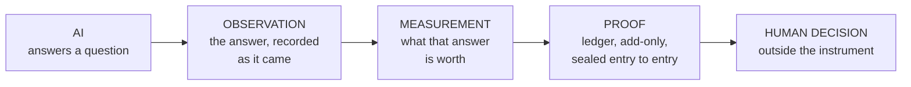

# NeoMundi Station

## When AI responds, NeoMundi measures.

Ask an AI a question. NeoMundi Station records the answer, measures what it is
worth, and keeps the proof — so that what an AI system said can be **shown to
someone else** instead of merely remembered.

🇫🇷 [Lire ce document en français](README.fr.md)

---

## What it does, in plain terms

An AI answers. That answer is usually seen once, in a chat window, and then
it is gone — no one can go back to it, and no one can show it to a third party.

Station closes that gap. It asks the question under **declared conditions**,
**records** the answer exactly as it came, asks the measurement API **what that
answer is worth**, and writes all three into a **ledger that can only be added
to** — each entry sealed to the one before it. Nothing is edited afterwards: a
correction is a new entry that points at the old one.

**Station does not decide anything.** It does not approve, block, filter or
rank. It establishes what happened and what it was worth, and hands that to
the people whose job it is to decide.

And it says when it cannot measure. A result it cannot qualify is recorded as
a **refusal**, not guessed — because a refusal is an honest result and a
plausible number is not.

---

## What it gives you

| You are | What Station gives you |
|---|---|
| **A developer or AI engineer** | **The record contracts, readable right now** — [`schemas/`](schemas/), 15 JSON schemas, no account, no key, nothing to install. They state exactly what gets written down for every answer an AI gives: the model that actually served it, the parameters that took effect, what was measured, and what could not be. If you have ever tried to reconstruct after the fact *what exactly your system answered last Tuesday*, that is the gap these contracts close. |
| **An AI engineer running evaluations** | A shape for the problem you already have: frozen questions, declared conditions, measurements kept **separate** from reference verdicts and both kept separate from your own conclusions. Failed measurements stay visible as refusals instead of silently becoming zeros — which is the usual way an evaluation pipeline starts lying to you. |
| **A researcher** | Versioned, frozen questions; declared execution conditions; the model that **actually** answered recorded next to the one requested; a refusal recorded as a result rather than guessed; and a comparability key that makes it impossible to silently average two different setups into one series. |
| **A company deploying AI** | Something to show a client, an auditor or a board: *this* is what the system answered, under *these* conditions, and *this* is what the answer was worth — evidence that can be checked, rather than a claim that has to be believed. |
| **A pilot team** | A ledger of your own. [Get in touch](https://neomundi.io). |

---

## How it works

| Step | What happens |
|---|---|
| **1 — AI** | A versioned, frozen question is put to a real model, under conditions written down in advance. |
| **2 — Observation** | The answer is recorded as it came, together with its fingerprint, its timing, and the model that **actually** served it — not merely the one asked for. |
| **3 — Measurement** | The measurement API is asked what it makes of that text. The signals it returns, the coverage it had, and the signals it could **not** measure are all recorded. |
| **4 — Proof** | Each step writes its own entry into an add-only ledger, sealed to the previous one. Any alteration breaks the seal and is detected. |
| **5 — Human decision** | What the result *means* is a judgement, and it stays with people. Station supplies the evidence; it never supplies the verdict. |

### Four things kept apart, always

**What the model answered** · **what the measurement says about it** ·
**whether it was right against a reference** · **what a human concludes.**

Blurring them is how you get clean-looking numbers that mean nothing. Station
keeps them in separate records, by design.

---

## Explore

| | |
|---|---|
| 🛰 **Live Station** | **<https://station.neomundi.org>** — the single instance. See [Access](#access-to-the-station). |
| 🧪 **Experiments** | [What an experiment will carry](#experiments), and why none is published yet. |
| 🔒 **Evidence** | [What is recorded, and what is withheld](#evidence). |
| 📘 **Documentation** | [The record contracts](#documentation) — 15 JSON schemas, readable now. |
| 🐍 **SDK** | [neomundi-python-sdk](https://github.com/neomundi-io/neomundi-python-sdk) — call measurement directly. Experimental; see [Integrations](#integrations). |
| 🔌 **MCP** | [neomundi-measurement-mcp](https://github.com/neomundi-io/neomundi-measurement-mcp) — one tool, for an agent. Experimental; see [Integrations](#integrations). |
| 🤝 **Pilots** | [neomundi.io](https://neomundi.io) — get in touch. |

---

## Experiments

An **experiment** is a question asked repeatedly under fixed conditions, so
that something can be established rather than asserted.

Station is **being prepared for public launch**, and experiments will be
**added here progressively, each one only after it has been validated.**

**Nothing is published here yet, and that is deliberate.** When an entry
appears, it will carry, in the same place:

- its **protocol** — the question, the conditions, the repetitions;
- its **status** — prepared, running, or closed;
- its **execution regime** — a live provider call, a replay of a frozen
  corpus, or a synthetic run;
- its **measurement version** and its **comparability key**;
- and **what it does not show** — plainly, in the same entry.

**No result, no rate and no series is published in this repository today.**
A number without its provenance is not a measurement, so it waits.

---

## Evidence

The ledger is **add-only and sealed entry to entry**: each record carries the
fingerprint of the one before it. Nothing is modified or deleted; a correction
is a new record referencing the old.

**What is recorded:** the question's fingerprint, the answer and its
fingerprint, the model actually served and how that was attested, the
parameters sent and the ones that took effect, timings, the measured signals
and their values, the coverage, the signals that could **not** be measured and
why, and — where a reference exists — the reference verdict with the version
of the evaluator that produced it.

**What the read-only API withholds:** questions and answers themselves are
never returned. You get their fingerprints and lengths. You can **verify** a
text you already hold; you cannot **discover** one you do not. There is no
policy stating who may read raw content — and the absence of a policy is not a
permission.

**An unmeasured signal stays empty.** It is never turned into a zero. A
declared zero is a real measurement, and treating an outage as a perfect score
is exactly the failure this rule prevents.

**What Station will never produce:** a single composite score, a ranking of
models, or a drift declared before the baseline it set itself has closed.
Those are rules of the instrument, not editorial caution.

---

## Documentation

**Available now — the record contracts.** [`schemas/`](schemas/) carries the
**15 JSON Schema documents** that define every entry the ledger accepts:
observation, measurement, measurement disclosure, evidence record, reference
evaluation, replay provenance, run, campaign, panel, protocol, prompt version,
provider profile, dataset manifest, item reference, item exclusion.

They are **contracts, not results.** They state what the instrument is
*required* to write down — which is the part anyone has to be able to check
before trusting a single number that comes out of it. Read them and you will
see, among other things, that the model actually served is recorded next to
the one requested, that an unmeasured signal stays empty, and that a
measurement which cannot be qualified is written as a refusal with its reason.

**Selected documentation will follow** — the measurement contract, what the
API refuses to return, and the method — reviewed piece by piece before it is
published here.

---

## Getting started

There is **no repository to clone and nothing to install here**: the
implementation is private, and this repository is the public surface of a
single hosted instrument.

**Start with the contracts.** [`schemas/`](schemas/) — 15 JSON schemas, no
account, no key, nothing to install. It is the fastest way to judge whether
this instrument records what you would need it to record, and it is the one
thing here you can check for yourself, today, in full.

Then: **the Station itself** at **<https://station.neomundi.org>** — see
[Access](#access-to-the-station). And for work on your own material,
[get in touch](https://neomundi.io).

### Integrations

**Two exist, both experimental, and what follows is what they do today —
not a roadmap.**

| | |
|---|---|
| [**neomundi-python-sdk**](https://github.com/neomundi-io/neomundi-python-sdk) | Calls the measurement API directly, without Station. **Not published to a package index**, so you install it from source. |
| [**neomundi-measurement-mcp**](https://github.com/neomundi-io/neomundi-measurement-mcp) | Exposes a single `measure_execution` tool, so an agent can measure what it produced. **Transport validated; its measurement contract is not yet validated in production.** |

**One caution matters more than the others, and it is practical rather than
legal.** The SDK targets a measurement version **older** than the one this
instrument audits: mixing results from the two into a single series would
break the comparability rule **without warning you**. Keep them in separate
series.

**Neither grants you a licence.** The MCP connector has no licence file at
all; the SDK carries a notice stating that the choice has not been made. See
[Licence](#licence).

---

## Access to the Station

**<https://station.neomundi.org>** is the single instance. There is one
Station, one address, and this repository is not a second one.

**It is being prepared for public launch, and access today is granted case by
case.** The reason is written down rather than hidden: the instance holds a
**single consultation credential with no per-client separation**, so whoever
holds it can read the whole ledger being served. Handing it out freely would
be handing out everything at once. Until per-client authorisation is designed
and tested, access is deliberately narrow — one holder at a time, a separate
ledger per use, and a new credential after any demonstration.

**So there is no open demonstration data today.** The contracts in
[`schemas/`](schemas/) are what you can inspect without asking anyone. For
work on your own material, [get in touch](https://neomundi.io).

---

## Licence

**No licence is declared on this repository, and that is a decision rather
than an oversight.**

A public repository without a licence file is **all rights reserved** by
default: you may read it and discuss it, and no right to copy, modify or
redistribute is granted. Concretely, today: reading and discussing — yes;
reuse in another project, redistribution, or derived work — no.

Choosing a licence is a decision still to be taken, and it does not belong to
this file. The same applies to the SDK and the MCP connector: neither grants
one either.

**Datasets keep their own licences**, declared when they are imported and
carried by their manifests — and **no third-party dataset content is published
here.**

---

## Security

Report privately: GitHub's private advisory on this repository, or the address
named in [`SECURITY.md`](SECURITY.md). **Never a public issue for a
vulnerability.**

`SECURITY.md` also names what counts as one — including a schema here that
would describe the ledger wrongly. Someone verifying a proof relies on these
contracts; if they misdescribe, the verification is worth nothing.

---

## What this repository is — and what it is not

**It is** the public surface of one hosted instrument: its contracts, its
rules, and the way in.

**It is not** the implementation — no source, no tests, no deployment, nothing
that can be installed or run. **It is not** a second Station. **It is not** a
publication of results: nothing measured is published here yet, and when it
is, each figure will carry its provenance or it will not appear. **It is not**
open source. And **it is not** a benchmark, a leaderboard or a drift detector
— the instrument is built to refuse all three.

### Contributing

There is no code here to patch. What is useful is a **schema that
misdescribes what the ledger records**, a measurement that does not measure
what it claims, or a statement in this repository that nothing establishes.
See [`CONTRIBUTING.md`](CONTRIBUTING.md) — and note that no licence covers a
contribution today, so open an issue before investing time.

---

*Station observes, measures, and keeps. It ranks no models, publishes no single
score, and declares no drift before the baseline it set itself has closed.
Those are rules, not stylistic caution.*
